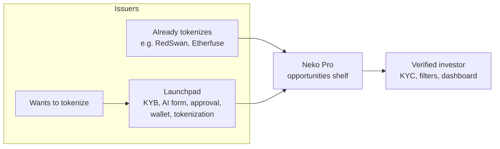
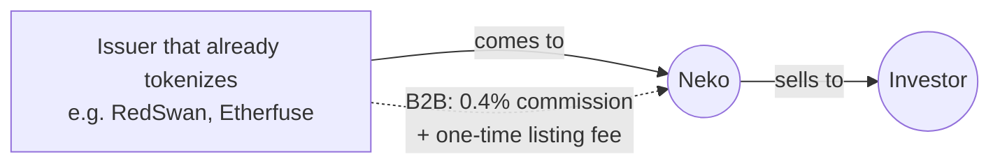
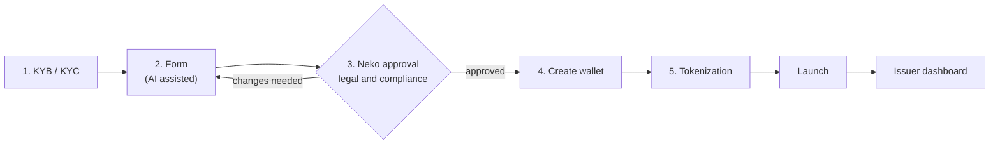
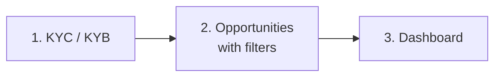

# Product flows

Mermaid diagrams. GitHub renders them here; paste into [mermaid.live](https://mermaid.live) to export PNG or SVG for the deck. Source: whiteboard of [session 01](../sessions/session-01.md).

## Full picture

## 1. Issuer that already tokenizes: distribution

## 2. Issuer that wants to tokenize: Launchpad

Looks for infrastructure (smart contracts, front end, back end), a legal structure and no jargon.

## 3. Investor: Neko Pro

