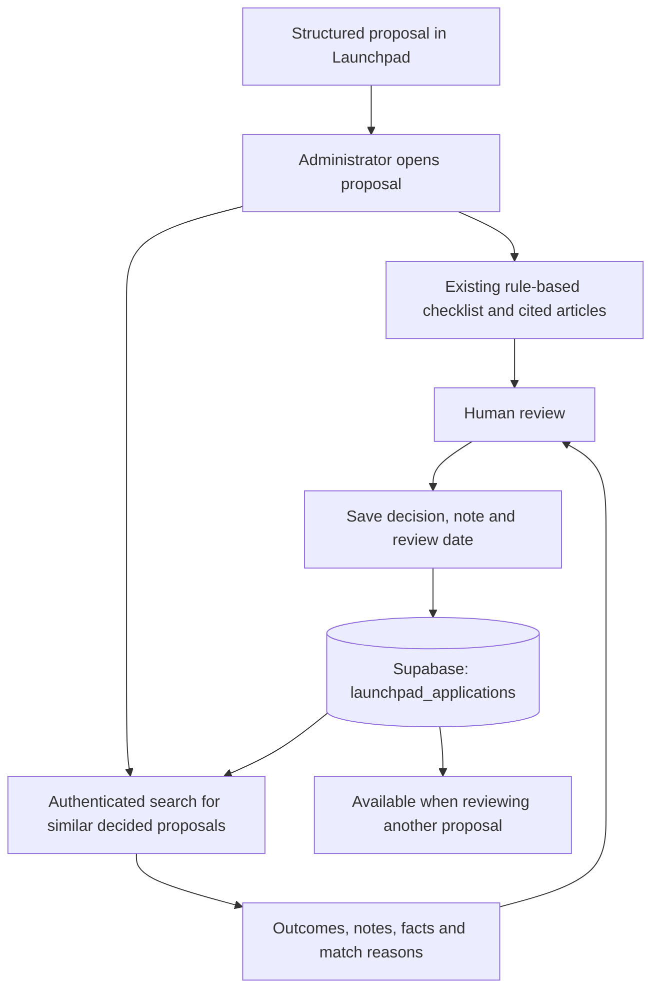

# Review memory: from a proposal to reusable review evidence

Neko Launchpad helps businesses prepare real-world asset proposals. Before an offering moves toward tokenization and investor distribution, a Neko administrator reviews the proposal. Review memory makes earlier decisions available at that point: the administrator can see comparable proposals, their outcomes, the reviewer's note, and why each case matched.

This closes a specific gap in the product. A checklist can identify a condition in the current proposal, but it cannot show how Neko handled a comparable proposal before. Stored decisions supply that operational context. The administrator remains responsible for the new decision.

## Delivery status and source of truth

Both implementation PRs are merged into `main`. The commits below are the snapshots the evidence in this guide was produced from:

| Component                 | Implementation snapshot                                                                                                                          | Delivery                                                                                |
| ------------------------- | ------------------------------------------------------------------------------------------------------------------------------------------------ | --------------------------------------------------------------------------------------- |
| NestJS search and scoring | Backend commit [`3a02d19`](https://github.com/Neko-Protocol/neko-backend-hackmeridian/commit/3a02d19ab4e4d8c025c80679ae695cee5534ebba)           | [Backend PR #5](https://github.com/Neko-Protocol/neko-backend-hackmeridian/pull/5)      |
| Next.js admin integration | Tokenization commit [`de9c26c`](https://github.com/Neko-Protocol/neko-tokenization-hackmeridian/commit/de9c26c2f01856ed93813244696d41c4a35464a5) | [Admin PR #16](https://github.com/Neko-Protocol/neko-tokenization-hackmeridian/pull/16) |

The behavior below is implemented in those snapshots and validated locally. Whether a given deployment runs that code is a separate question: check the commit each service was built from. Since then the same search was extracted into `PrecedentsService` in the backend, which also serves an anonymised view to the issuer's assistant (see below).

## How this fits the complete Neko solution

Neko connects two sides: businesses preparing an asset offering through Launchpad, and eligible investors discovering opportunities through the investor app. The review step sits between proposal preparation and the intended issuance/distribution flow. Review memory strengthens this step without claiming to complete the later stages.

| Layer                       | Responsibility                                                                                    | Relationship to this change                                                                                                                                                                 |
| --------------------------- | ------------------------------------------------------------------------------------------------- | ------------------------------------------------------------------------------------------------------------------------------------------------------------------------------------------- |
| Issuer application          | Collect structured asset, offering and investor details; support preparation with an AI assistant | Supplies the fields compared by the search. The issuer assistant now calls the same search through `find_precedents`, with an anonymised view and only the fields the issuer has filled in. |
| Legal knowledge base        | Retrieve stored legal articles and cited obligation documents                                     | Supplies legal context to the existing review experience. Case search does not treat reviewer notes as law.                                                                                 |
| Compliance checklist        | Evaluate explicit rules against the current proposal and display cited articles                   | Continues to run separately, with its existing rules unchanged.                                                                                                                             |
| Review memory               | Retrieve earlier decided proposals and explain the field matches                                  | Added by these two PRs.                                                                                                                                                                     |
| Human review                | Approve, reject or request changes and record a note                                              | Remains the decision authority. Its saved result becomes available to future searches.                                                                                                      |
| Tokenization and investment | Contract issuance, eligibility controls, distribution and investment                              | Separate product stages. The case search does not issue tokens, move funds or enforce contract restrictions.                                                                                |

The [product diagrams](diagrams.md), [contract documentation](../contracts/README.md) and [Legal KB documentation](../services/legal-kb/README.md) describe the surrounding work and its own limitations. In particular, displaying a legal check or prior decision does not establish that an equivalent restriction is enforced on-chain.

## The implemented feedback loop



The existing decision endpoint saves `status`, `review_note`, `reviewed_by` and `reviewed_at` on the application row. Searches read the database at request time rather than a seeded example list or a separately trained model. A newly saved eligible decision can therefore become a candidate for the next search without a training or indexing job. It appears in the returned list only if it matches and ranks within the requested limit.

“Learns from every decision” means the available case memory grows as reviews are stored. The scoring weights stay fixed. Current rows hold the latest decision; this is not an immutable history of every intermediate review.

## Search contract and ranking

```http
GET /v1/launchpad/admin/applications/:id/similar?limit=5
Authorization: Bearer <admin-session-token>
```

The endpoint lives in the existing admin controller. It uses `AdminAuthGuard`, UUID validation, a limit DTO and the existing throttling pattern. The browser calls the existing backend proxy, which forwards the admin bearer token and adds the server-side internal key. The internal key identifies the proxy; the admin guard checks the caller's administrative session.

Candidates must have status `approved`, `rejected` or `changes_requested`. The target itself and undecided applications are excluded. Scoring uses seven explicit signals:

| Matching signal                                             | Points |
| ----------------------------------------------------------- | -----: |
| Asset type                                                  |      3 |
| Offering type                                               |      2 |
| Issuer country                                              |      2 |
| Target amount between 0.5 and 2 times the target, inclusive |      1 |
| At least one overlapping investor country                   |      1 |
| US-investor policy, including matching `false`              |      1 |
| Mass-marketing policy, including matching `false`           |      1 |

The maximum is 11. Positive scores qualify. The service scans candidates in pages of 500, retaining the best results, so the first Supabase response page does not define the search universe. Ordering is score descending, review date descending, then ID ascending. `limit` defaults to 5 and accepts integers from 1 to 20.

Each case includes its ID, asset name/type, issuer country, offering type, amount/currency, decision, reviewer note/date, score and `matched` reasons. `summary` counts outcomes **only among returned cases**. It is not a population statistic, approval rate, model confidence or recommendation.

For example, a summary of two approved cases and one rejected case lets the reviewer inspect those three decisions. It does not imply that the current proposal has a two-thirds chance of approval. Similarities make cases worth examining; the recorded notes and current proposal still need human interpretation.

## User-visible behavior

The `SimilarCases` component appears within the compliance panel, alongside the existing checklist. Each result links to its proposal and shows the outcome badge, short facts, review date, note and match reasons. Missing notes are explicitly identified.

An empty database or a search without eligible matches produces:

> No similar decided cases yet. Each review you make here is remembered for the next one.

A request failure produces an error and a retry button instead of the empty state. Request state is keyed by proposal, session token and retry attempt; navigating to another proposal clears stale displayed cases and ignores responses from the previous effect. Checklist loading and case-search loading are independent.

## Evidence map

These links pin the implementation revisions rather than assuming the current `main` branch contains both PRs.

| Behavior                                                                            | Source evidence                                                                                                                                                                                                                                                                                                                                                     |
| ----------------------------------------------------------------------------------- | ------------------------------------------------------------------------------------------------------------------------------------------------------------------------------------------------------------------------------------------------------------------------------------------------------------------------------------------------------------------- |
| Seven signals and readable match reasons                                            | [`scoreApplicationSimilarity`](https://github.com/Neko-Protocol/neko-backend-hackmeridian/blob/3a02d19ab4e4d8c025c80679ae695cee5534ebba/src/domains/launchpad/application-similarity.ts)                                                                                                                                                                            |
| Persisted decisions, candidate filtering, paging, ordering and returned-case counts | [`ApplicationsService.adminDecide` and `adminSimilar`](https://github.com/Neko-Protocol/neko-backend-hackmeridian/blob/3a02d19ab4e4d8c025c80679ae695cee5534ebba/src/domains/launchpad/applications.service.ts)                                                                                                                                                      |
| Admin route, UUID parsing and throttle declaration                                  | [`AdminApplicationsController`](https://github.com/Neko-Protocol/neko-backend-hackmeridian/blob/3a02d19ab4e4d8c025c80679ae695cee5534ebba/src/domains/launchpad/applications.controller.ts)                                                                                                                                                                          |
| Limit conversion and bounds                                                         | [`SimilarApplicationsQueryDto`](https://github.com/Neko-Protocol/neko-backend-hackmeridian/blob/3a02d19ab4e4d8c025c80679ae695cee5534ebba/src/domains/launchpad/dto/similar-applications-query.dto.ts)                                                                                                                                                               |
| Backend response fields                                                             | [`SimilarApplicationsResponse` and `SimilarApplicationCase`](https://github.com/Neko-Protocol/neko-backend-hackmeridian/blob/3a02d19ab4e4d8c025c80679ae695cee5534ebba/src/domains/launchpad/launchpad.types.ts)                                                                                                                                                     |
| Browser API call and server-side proxy forwarding                                   | [`getSimilarApplications`](https://github.com/Neko-Protocol/neko-tokenization-hackmeridian/blob/de9c26c2f01856ed93813244696d41c4a35464a5/apps/admin/src/lib/admin-api.ts), [proxy route](https://github.com/Neko-Protocol/neko-tokenization-hackmeridian/blob/de9c26c2f01856ed93813244696d41c4a35464a5/apps/admin/src/app/api/backend-proxy/%5B...path%5D/route.ts) |
| Rendering, empty/error/retry states and stale-response handling                     | [`SimilarCases`](https://github.com/Neko-Protocol/neko-tokenization-hackmeridian/blob/de9c26c2f01856ed93813244696d41c4a35464a5/apps/admin/src/features/compliance/SimilarCases.tsx)                                                                                                                                                                                 |
| Placement in the existing review workflow                                           | [`CompliancePanel`](https://github.com/Neko-Protocol/neko-tokenization-hackmeridian/blob/de9c26c2f01856ed93813244696d41c4a35464a5/apps/admin/src/features/compliance/CompliancePanel.tsx)                                                                                                                                                                           |

## Validation and what it establishes

The implementation run added 45 passing backend tests:

| Test suite                                                                                                                                                                                                            | Count | Coverage                                                                                                              |
| --------------------------------------------------------------------------------------------------------------------------------------------------------------------------------------------------------------------- | ----: | --------------------------------------------------------------------------------------------------------------------- |
| [`application-similarity.spec.ts`](https://github.com/Neko-Protocol/neko-backend-hackmeridian/blob/3a02d19ab4e4d8c025c80679ae695cee5534ebba/src/domains/launchpad/application-similarity.spec.ts)                     |    19 | Signal weights, inclusive amount bounds, numeric strings, boolean policies, zero matches and empty country lists      |
| [`applications-similar.spec.ts`](https://github.com/Neko-Protocol/neko-backend-hackmeridian/blob/3a02d19ab4e4d8c025c80679ae695cee5534ebba/src/domains/launchpad/applications-similar.spec.ts)                         |     7 | Candidate filtering, payload, ranking, counts, later-page matches, empty memory, missing target and database failures |
| [`applications-similar.controller.spec.ts`](https://github.com/Neko-Protocol/neko-backend-hackmeridian/blob/3a02d19ab4e4d8c025c80679ae695cee5534ebba/src/domains/launchpad/applications-similar.controller.spec.ts)   |     8 | HTTP routing, admin guard with mocked token verification, default/explicit limits and invalid inputs                  |
| [`similar-applications-query.dto.spec.ts`](https://github.com/Neko-Protocol/neko-backend-hackmeridian/blob/3a02d19ab4e4d8c025c80679ae695cee5534ebba/src/domains/launchpad/dto/similar-applications-query.dto.spec.ts) |    11 | Query conversion, default, valid boundaries and invalid limits                                                        |

Backend and admin production builds passed. Admin ESLint and TypeScript checks passed. Local Chrome checks covered empty and populated states, notes, failed requests, retry and navigation at desktop and 390px mobile widths. Browser responses were intercepted test fixtures; they were never inserted into Supabase. These checks validate rendering and request behavior, not a live cross-service deployment.

The full backend run had 47 passing suites and five failing suites, with 472 passing tests and one failing test. The same five suites failed on the unchanged baseline commit `7e98e312a1aa23c4e9d174ab7b17bd29ab4c56ae`: CORS error wording, a missing sibling migration directory, Blend SDK type conflicts and ESM loading in two pool-rate suites. Backend lint could not run because ESLint and its configuration were absent. These are recorded limitations, not a fully green repository result.

Reproduction commands, run against the corresponding implementation revisions:

```bash
# Backend repository
npm ci --ignore-scripts --no-audit --no-fund
npm run build
npm test -- --runInBand --testPathPattern='application-similarity|applications-similar|similar-applications-query'
npm test -- --runInBand

# Tokenization repository
npm run lint -- --filter=@neko-tokenization/admin
npx --no-install tsc --noEmit -p apps/admin/tsconfig.json
npm run build -- --filter=@neko-tokenization/admin
```

## Boundaries and remaining validation

- No database migration or example-case seed is required. Results depend on actual stored decisions; the UI does not fabricate a case history on first use.
- The current policy compares nominal amounts across currencies without FX conversion. Scores can be weak matches, including matches on the two boolean policies alone; the minimum is greater than zero, not a calibrated relevance threshold.
- Candidate scanning is appropriate to this version's simple design. Larger datasets need performance measurement and potentially database-side candidate selection.
- Current application rows supply the latest decision. Full revision history, immutable decision events and retention guarantees require additional design.
- Reviewer notes are historical context, not verified legal authority. Past approvals do not establish compliance for a new proposal.
- The issuer AI assistant calls this search through `find_precedents` with an anonymised view (no names, IDs, reviewer notes, documents or exact amounts of other issuers). This change does not add autonomous decisions, contract restrictions or an on-chain review record.
- A deployed acceptance run still needs an authorized admin session and real review records to verify the complete browser → proxy → backend → Supabase path.
- Faster reviews and more consistent decisions are intended product benefits. No measured time savings, decision-quality benchmark, user-adoption results or accuracy percentage were established in this work.

The delivered contribution is a traceable review step: current proposal facts, cited rule checks and comparable human decisions can be inspected together, while each saved eligible decision becomes available for later review.
